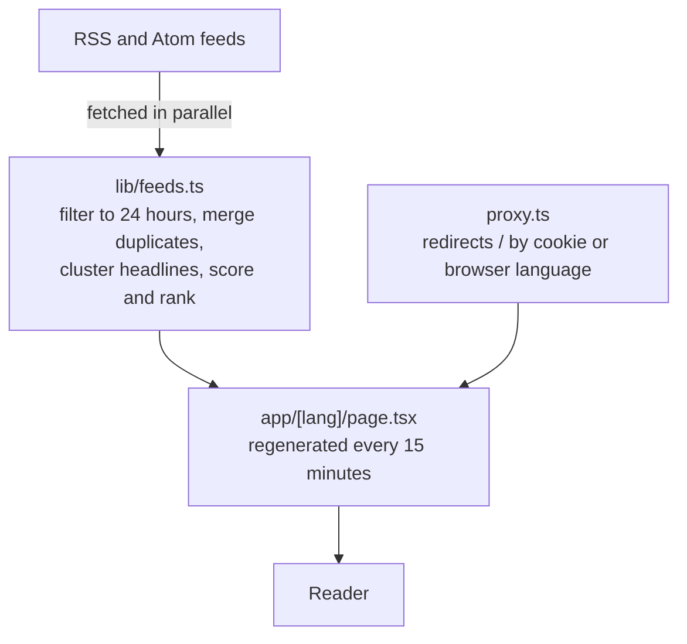

# Tech Blogs

[](https://github.com/Hakimi404/Tech_Blogs/actions/workflows/ci.yml)

**The last 24 hours in AI and technology, on one newspaper-style front page.**

Live at **[news.alhakimi.de](https://news.alhakimi.de)**, in [English](https://news.alhakimi.de/en) and [German](https://news.alhakimi.de/de).

## Overview

Tech news is spread across dozens of sites, and the same story shows up on many of them. Tech Blogs reads 65 RSS and Atom feeds, keeps what was published in the last 24 hours, groups headlines about the same event and ranks the result. A story covered by several outlets rises toward the top.

| Edition | Publishers | Feeds |
| --- | --- | --- |
| English (`/en`) | 37 | 40 |
| German (`/de`) | 23 | 25 |

## Features

- **Headline clustering:** groups reports of the same event by word overlap, in English and German.
- **Ranking:** the five-story front page is scored on the number of outlets, Hacker News points, recency and topic.
- **Sections:** AI, Industry, Gadgets & Hardware, Security and Developers. AI and security stories from general outlets are re-filed by keyword.
- **Filtering:** merges the same article from different feeds, drops coupon pages and keeps shopping posts off the front page.
- **Fault tolerance:** a failed feed doesn't stop the page. Its publisher is marked as unavailable in the footer.
- **Language and theme:** `/` opens the edition matching the browser language. A reader's language and light/dark choices are remembered.
- **Editorial design:** masthead, column rules and drop caps, based on the Editorial style in [Tilda's web design guide](https://tilda.education/en/web-design-styles).

## Tech stack

Next.js 16 (App Router, Incremental Static Regeneration), React 19, TypeScript, rss-parser, Vercel. It has no database and needs no API keys.

## Architecture



| File | Purpose |
| --- | --- |
| [`lib/sources.ts`](lib/sources.ts) | Feed list. Add any RSS or Atom feed and set `lang` to choose its edition. |
| [`lib/feeds.ts`](lib/feeds.ts) | Fetching, filing, merging, clustering and ranking. |
| [`app/[lang]/page.tsx`](app/[lang]/page.tsx) | Server-rendered page for each edition. |
| [`app/components/client.tsx`](app/components/client.tsx) | Theme toggle, language switch, live timestamps and page refresh. |
| [`lib/i18n.ts`](lib/i18n.ts) | All interface text in both languages. |
| [`lib/site.ts`](lib/site.ts) | Site name, author, refresh interval and launch date. |

## Getting started

**Prerequisites:** Node.js 22 and npm. No configuration or environment variables are needed.

```bash
npm install
npm run dev
```

Open http://localhost:3000. The first load of each edition takes a few seconds while the feeds are fetched.

To deploy, import the repository into Vercel and keep the Next.js defaults.

## Testing

There are no automated tests yet. CI runs on every push and pull request:

```bash
npm run lint
npm run build   # also type-checks the project
```

## Status

Active and running in production. The next step is adding unit tests for clustering and ranking in `lib/feeds.ts`.

## Technical challenges

- **Clusters that drift:** one loosely related headline can pull unrelated stories into a group. A new headline must match the group as a whole (average-link, IDF-weighted Dice score), share at least two words, and come from a publisher not already in the group.
- **Two languages in one pipeline:** JavaScript's `\b` only recognises ASCII letters, so German words with umlauts break naive matching. The tokenizer uses Unicode property escapes, and the keyword patterns account for the missing boundary.
- **Stale cached pages:** with Incremental Static Regeneration, a visitor can get the previous copy while a new one is built. An open page detects this and asks for the fresh copy shortly afterwards.
- **Theme flash:** a small inline script applies the saved theme before the first paint, so the wrong theme never shows.

## License

[MIT](LICENSE)
